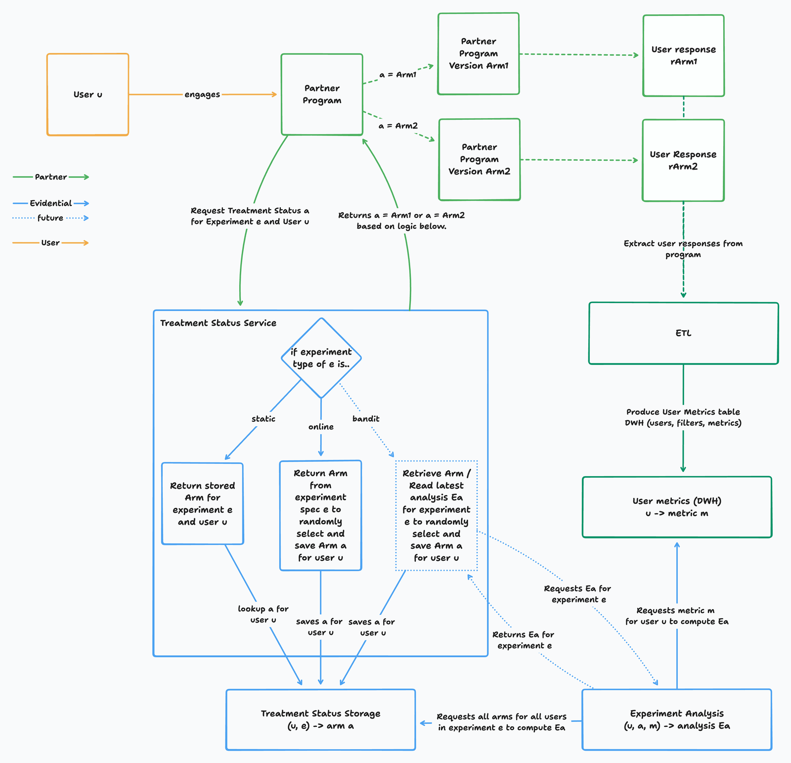

Evidential helps your organization implement experiments.

We provide:

- a friendly UI for you to design, validate, execute, and analyze experiments.
- an [integration API](/api/) for your developers to integrate the treatments with your application.
- built-in integrations with [messaging platforms](/guides/integrate-with-messaging-platforms/), so treatments can be
    delivered over your existing chat channels.

## Responsibility Diagram

The diagram below illustrates the lifecycle of an experiment. The blue boxes describe Evidential's role in an
integration.

